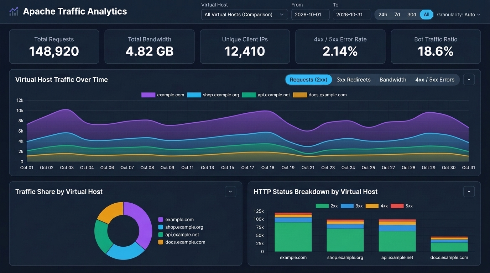
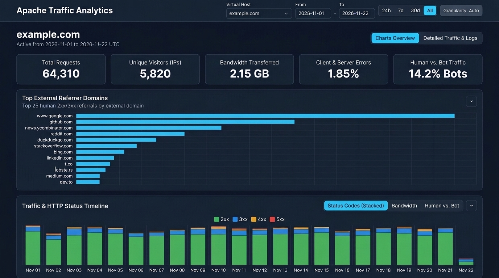

# Apache Multi-Vhost Static HTML Traffic Analyzer

A fast, zero-database Perl static HTML + Chart.js report generator for Apache access logs across multiple virtual hosts. Run it on a schedule or on demand to produce self-contained, interactive dashboards in `output/`—no backend daemon or SQL server required.

## Quick Start

### 1. Create Your Configuration
Copy the example configuration and point `log_sources` at your Apache access logs:
```bash
cp config/traffic.json.example config/traffic.json
```

### 2. Generate the Static HTML Reports
```bash
# Ingest new log lines from configured sources and build output/
perl bin/build_reports.pl
```
Open `output/index.html` in your browser, or serve `output/` directly behind Apache using `config/apache-vhost.conf`.

### Common CLI Options
```bash
# Parse specific log file(s) directly (supports %v shared logs, per-vhost logs, and .gz archives)
perl bin/build_reports.pl --file /var/log/apache2/other_vhosts_access.log
perl bin/build_reports.pl --file /var/log/apache2/example.com-access.log --vhost example.com

# Write reports to a custom directory (e.g., an Apache DocumentRoot)
perl bin/build_reports.pl --output-dir /var/www/html/traffic

# Regenerate HTML/assets from existing state without re-reading logs
perl bin/build_reports.pl --rebuild-only

# Clear saved state and perform a full re-ingestion from scratch
perl bin/build_reports.pl --reset
```

---

## Screenshots

### All Virtual Hosts — Comparison Overview (`output/index.html`)
Compare traffic, bandwidth share, and HTTP status breakdowns across every virtual host using the Time Window (`24h`, `7d`, `30d`, `All`, or custom dates) and Granularity controls.



### Single Virtual Host — Charts Overview (`output/vhosts/<vhost>.html`)
Inspect a single domain's KPIs, top 25 human external referrer domains, status/bandwidth/bot timeline, HTTP methods, client categories, content types, and error codes—all filtered by the active Time Window.



---

## Configuration (`config/traffic.json`)

| Option | Description |
| :--- | :--- |
| `state_file` | Path to the incremental JSON state file (default: `state/traffic_state.json`). |
| `output_dir` | Directory where static HTML, CSS, and JS files are written (default: `output`). |
| `raw_retention_days` | Number of days to retain recent raw log entries for the Log Explorer (default: `30`). |
| `max_recent_logs_per_vhost` | Maximum recent raw log entries kept per virtual host (default: `1000`). |
| `default_vhost_from_filename` | Derive the virtual host name from the log filename when `%v` is absent. |
| `filename_vhost_regex` | Regex used to extract the virtual host name from log filenames. |
| `vhost_colors` | Optional map of virtual host names to hex colors so hosts keep consistent colors across **Virtual Host Traffic Over Time**, **Traffic Share by Virtual Host**, and the comparison table. Pinned colors are automatically excluded from the palette assigned to other hosts. |
| `log_sources` | Array of `{ "path": "...", "vhost": "...", "skip_common_format": false }` entries. |

### Pinning Virtual Host Colors (`vhost_colors`)
By default, hosts are assigned deterministic colors alphabetically. To pin specific hosts to fixed colors (for example, keeping your primary domain purple), add `vhost_colors` to `config/traffic.json`:

```json
{
  "vhost_colors": {
    "example.com": "#a855f7",
    "shop.example.org": "#38bdf8"
  }
}
```

---

## Features & Generated Pages

- **`output/index.html` — All Virtual Hosts Comparison**:
  - Multi-vhost timeline (**Requests (2xx)**, **3xx Redirects**, **Bandwidth**, **4xx / 5xx Errors**), **Traffic Share** doughnut, **HTTP Status Breakdown**, **Fail2ban Apache Protection Status** (when `fail2ban-client` is available), and sortable comparison table.
- **`output/vhosts/<vhost>.html` — Single Virtual Host Charts Overview**:
  - **Top External Referrer Domains** (top 25 human 2xx/3xx referrers with every bar labeled), **Traffic & HTTP Status Timeline**, **HTTP Methods**, **Client Categories**, **Content Types (Pages vs. Files)**, and **Error Status Codes**, all dynamically filtered by the selected Time Window.
- **`output/vhosts/<vhost>-details.html` — Detailed Traffic & Logs**:
  - Filterable **Top Endpoints** (Pages/API, Images, CSS/JS/Fonts, Other Files), **Client IPs**, **User-Agents & Referrers/Campaigns** (`utm_*` and click IDs), **4xx/5xx Error Inspector**, and a paginated **Recent Request Log Explorer**.
- **Collapsible Panels**: Every panel includes a header toggle button (`▾`) whose collapsed/expanded state is remembered in `localStorage`.
- **Incremental State (`state/traffic_state.json`)**: Tracks each file's `inode` and byte offset so repeated runs only parse new lines and handle log rotation (including `.gz` archives) automatically.

---

## Running Tests

```bash
prove -l -v t/
```
